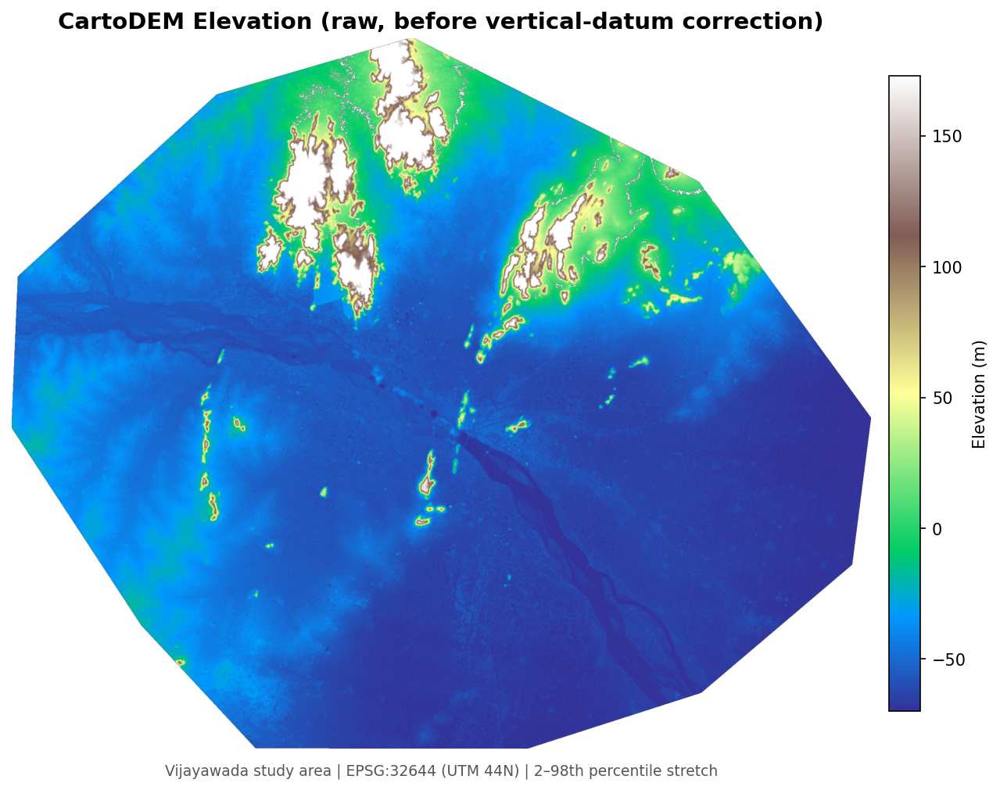
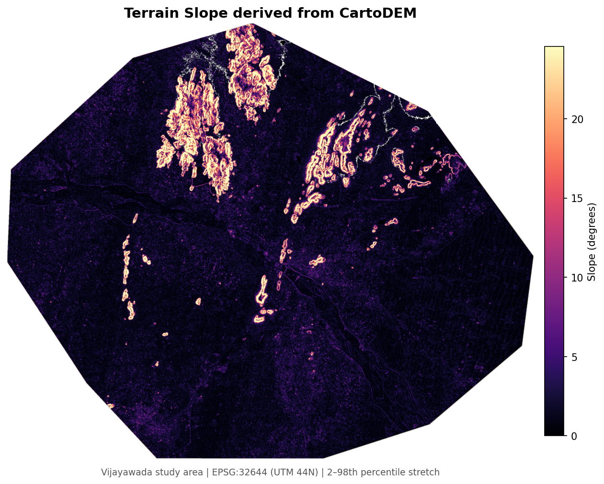
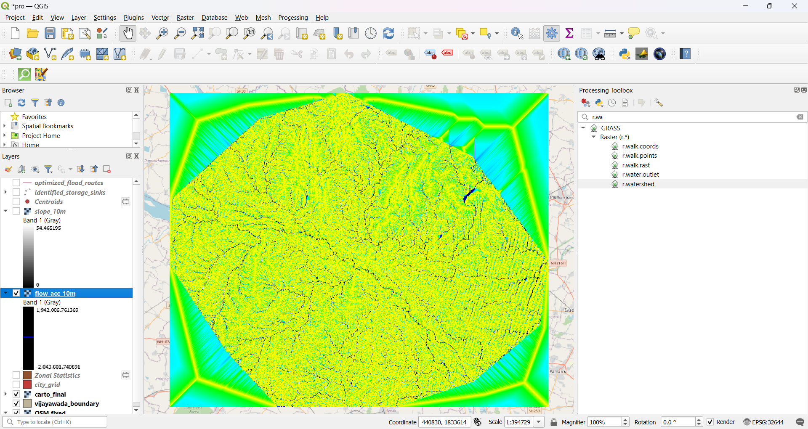
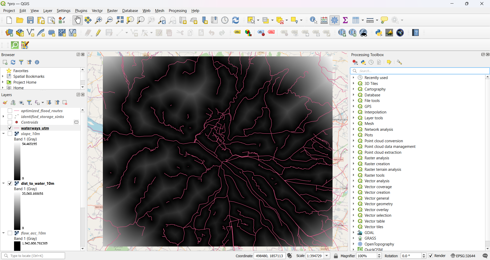
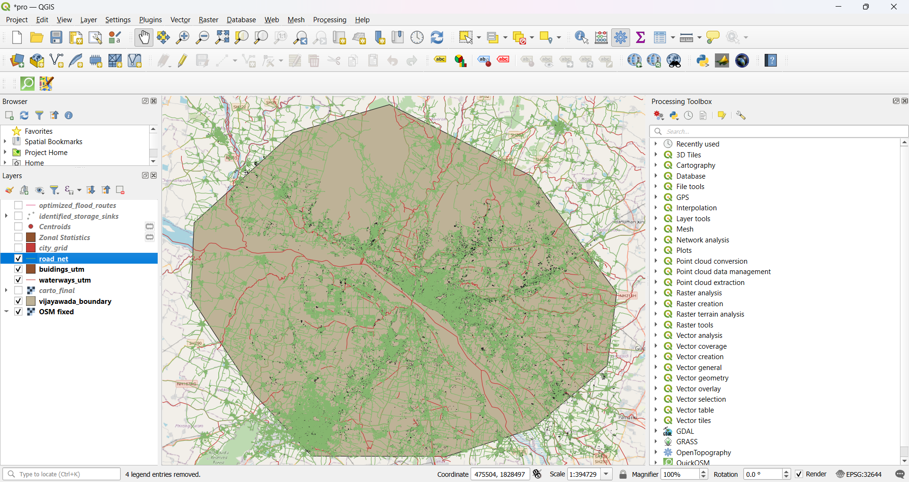
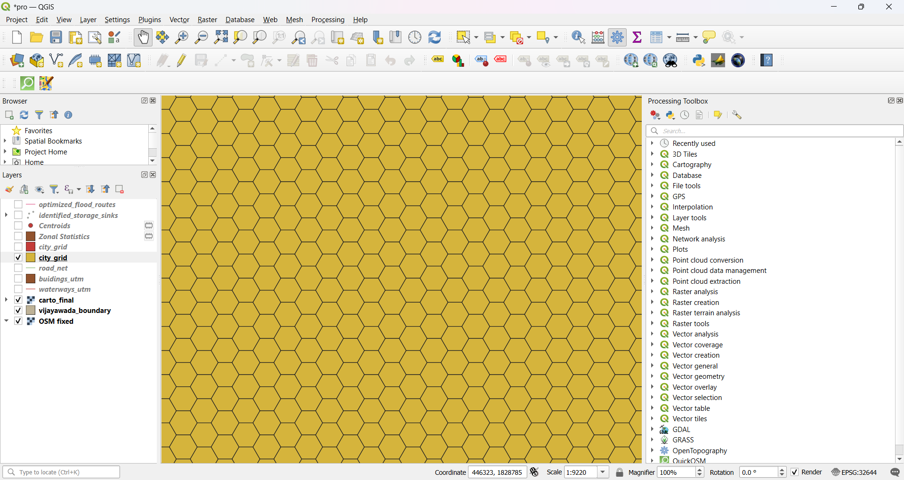
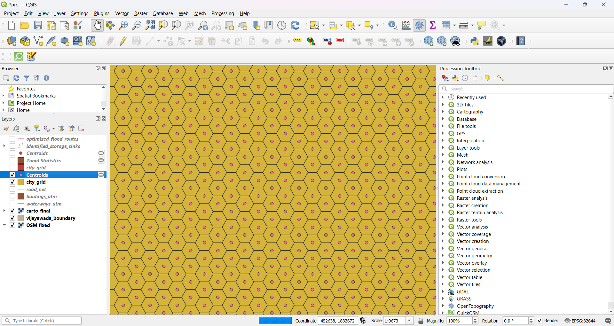
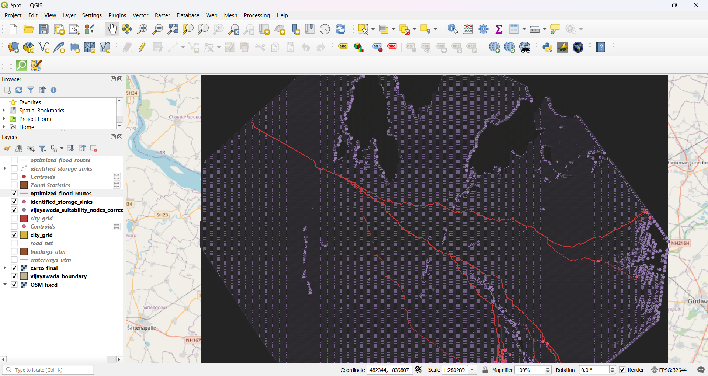
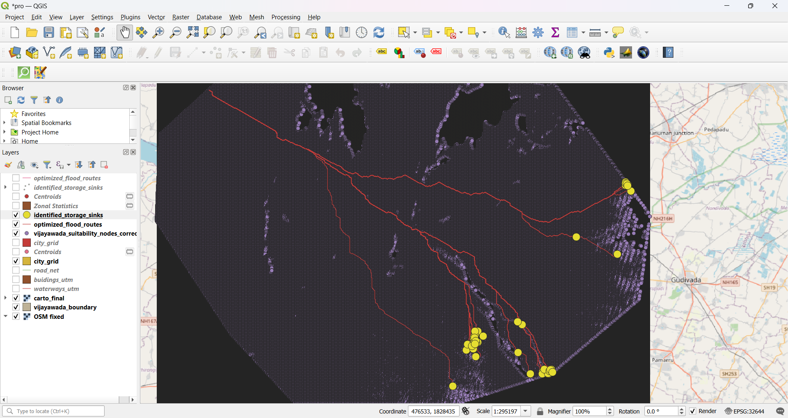
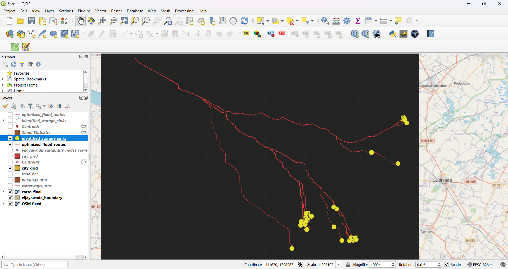

# Raster and Vector Data Analyses: Visual Results

What each step of the spatial pipeline produced, in the order it was run.

## 01_Raster_Analyses: hydrological parameters

| | |
|---|---|
|  | **CartoDEM elevation (raw).** Note the delta floodplain at negative heights. This is the vertical-datum problem fixed in Phase 4b. |
|  | **Slope** derived from CartoDEM. The delta is almost uniformly flat (< 1°). |
|  | **Flow accumulation** (GRASS `r.watershed`). Used for the Topographic Wetness Index. |
|  | **Distance to water** (QGIS Proximity on rivers/waterways). |

## 02_Vector_Analyses: spatial discretisation

| | |
|---|---|
|  | OSM roads, buildings and POIs clipped to the study boundary. |
|  | The 393,794-cell, 100 m hexagonal grid (`city_grid.shp`). |
|  | Zonal-statistics attribute table, the bridge from GIS to the ML dataset. |

## 03_Combined_Analytical_Results: synthesis

| | |
|---|---|
|  | LightGBM-based storage-suitability heatmap. |
|  | Top 50 uninhabited storage sinks. |
|  | 50 least-cost routes from the Prakasam Barrage (Dijkstra). |

> Raster panels 01 and 02 are rendered previews of the original GeoTIFFs (2–98th percentile stretch). The source rasters are not committed because of their size.
