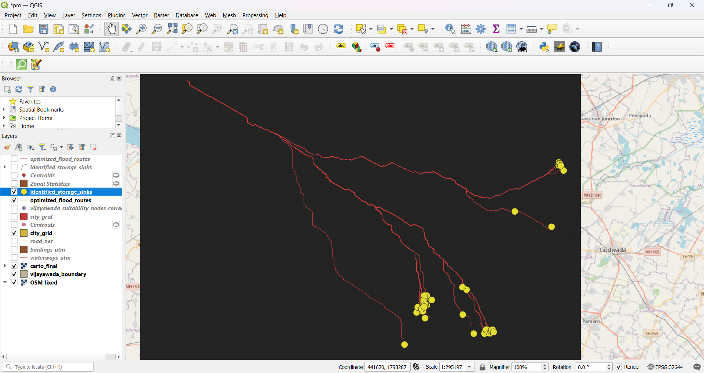
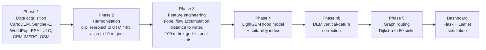

# Optimized Floodwater Routing for Vijayawada

**A GIS + machine-learning decision-support system that finds safe temporary storage zones for floodwater and the least-damaging paths to move water there from the Prakasam Barrage.**



▶ **Demo video:** [`05_Video_Demo/Geota_ProjectDemo.mp4`](05_Video_Demo/Geota_ProjectDemo.mp4) (walkthrough of the QGIS analysis, dashboard and query explorer)

---

## The problem

Vijayawada sits on the flat Krishna delta immediately downstream of the Prakasam Barrage. During heavy releases and Budameru overflows (2019, 2020, 2022, 2024), water spreads into dense urban wards. This project asks:

1. **Where** can floodwater be stored temporarily with the least harm to people? (uninhabited, low-lying, historically flood-prone land)
2. **How** should water be routed there so it crosses as few people and urban areas as possible?

## Results at a glance

| Output | Value |
|---|---|
| Study grid | 393,794 hexagons (100 m), EPSG:32644 / UTM 44N |
| Routable nodes after DEM correction | 342,573 |
| Flood classifier | LightGBM, class-weighted, **ROC-AUC 0.8195** on held-out data |
| Storage sinks identified | 50, all with **zero resident population**, elevation 0.1–2.4 m, suitability 0.965–0.979 |
| Routes generated | 50 least-cost paths (Dijkstra), avg ≈ 69 km, avg elevation drop 25.9 m |
| Interactive DSS | Flask + Leaflet dashboard with a time-stepped flood-wave simulation |

## Pipeline



Phases 1–3 were carried out in **QGIS 3.40 / GRASS GIS** (screenshots in `01_Quick_Look_Screenshots/`). Phases 4–5 and the dashboard are Python (in `03_Source_Code/`).

### Key methodological decisions

- **Hexagonal 100 m grid.** Equal-distance neighbours give an unbiased routing graph, and zonal statistics turn rasters into a tabular ML dataset.
- **Physics-based features.** Topographic Wetness Index `ln(a / tan β)`, a vulnerability index, distance² and an elevation × slope interaction. Rainfall was **dropped** because it has almost no spatial variance at city scale.
- **Class imbalance.** Flood hexagons are the minority class, so `scale_pos_weight` and a stratified split are used and ROC-AUC is reported alongside accuracy.
- **Suitability index:** `0.5·P(flood) + 0.3·(1 − population) + 0.2·(1 − urban)`. Land that already floods and where nobody lives scores highest.
- **DEM vertical-datum correction.** The CartoDEM mosaic put the delta floodplain at negative heights (hexagon median −54.8 m) while hill tiles used a different reference. Left as-is, routing treats the river as far above the delta. Benchmarking against published heights (Indrakeeladri, Kondapalli, Prakasam Barrage) led to a **+69.7 m** shift on delta nodes, giving a corrected median of **15.6 m MSL** (see `06_Presentation_Figures/slide07_*`).
- **Undirected least-cost routing.** The delta gradient is below 0.1 % at 100 m, too flat for gravity-directed routing on averaged elevations. Edge cost = population penalty + (1 − suitability) + a small elevation penalty.

## Repository structure

```
├── 01_Quick_Look_Screenshots/     Visual results of every raster/vector/ML step
│   ├── 01_Raster_Analyses/        DEM, slope, flow accumulation, distance to water
│   ├── 02_Vector_Analyses/        OSM clip, hex grid, zonal statistics table
│   └── 03_Combined_Analytical_Results/  suitability heatmap, top-50 sinks, routes
├── 02_GIS_Outputs/
│   ├── ml_inputs/                 Phase 3 zonal-statistics table (model input, gzipped)
│   ├── ml_intermediate/           Phase 4 suitability nodes before DEM correction (gzipped)
│   └── vector/                    Study boundary, rivers, waterways, waterbodies, POIs
├── 03_Source_Code/
│   ├── 1_ML_and_Routing_Pipeline/ Phase 4, 4b, 5 scripts + diagnostics
│   └── 2_Web_Simulation_Dashboard/  Flask app, simulation engine, Leaflet UI
├── 04_Final_System_Outputs/       Final sinks, routes and corrected nodes
├── 05_Video_Demo/                 Project walkthrough video
└── 06_Presentation_Figures/       Figures used in the presentation + model diagnostics
```

## Quick start

```bash
git clone https://github.com/anisheda3/flood-routing-gis.git
cd flood-routing-gis
python -m venv .venv && source .venv/bin/activate   # Windows: .venv\Scripts\activate
pip install -r requirements.txt
```

### Run the dashboard

```bash
python 03_Source_Code/2_Web_Simulation_Dashboard/app.py
# open http://localhost:5000
```

The dashboard reads the committed files in `04_Final_System_Outputs/` and `02_GIS_Outputs/vector/`, so no preprocessing is needed.

### Reproduce the pipeline

All scripts use repo-relative paths (`03_Source_Code/1_ML_and_Routing_Pipeline/paths.py`) and can be run from any directory:

| Step | Script | Input → Output | Runtime |
|---|---|---|---|
| 4 | `phase4_suitability_model.py` | `ml_inputs/vijayawada_dataset.csv.gz` → `ml_intermediate/vijayawada_suitability_nodes.csv.gz` | ~2–5 min |
| 4b | `phase4b_elevation_correction.py` | → `04_Final_System_Outputs/vijayawada_suitability_nodes_corrected.csv` | seconds |
| 5 | `phase5_flood_routing.py` | → `optimized_flood_routes.geojson`, `identified_storage_sinks.csv` | several min |
| – | `inspect_routes.py` | prints summary statistics of the routes and sinks | seconds |
| – | `dem_benchmark_diagnostics.py` | exploratory benchmark analysis behind the datum correction | seconds |

**Reproducibility check:** starting from the committed Phase 4 output, Phases 4b and 5 regenerate `vijayawada_suitability_nodes_corrected.csv`, `optimized_flood_routes.geojson` and `identified_storage_sinks.csv` **byte-for-byte** (50/50 routes, 0 failures, source component covers 99.7 % of nodes).

## Data sources

| Dataset | Use |
|---|---|
| ISRO CartoDEM (10 m) | Master elevation; slope; flow accumulation; TWI |
| ALOS PALSAR / SRTM | Secondary DEMs for coverage/consistency checks |
| Sentinel-1 SAR (2019, 2020, 2022, 2024 events) | Flood labels (`fld_majority`) |
| ESA WorldCover | Land use / urban penalty |
| WorldPop 2020 (UN-adjusted) | Population penalty |
| NASA GPM IMERG | Rainfall (evaluated, dropped for low spatial variance) |
| HydroRIVERS, OpenStreetMap | Rivers, waterways, roads, buildings, POIs |

### What is not in this repo (and why)

The full raster stack and intermediate GIS layers (about 14 GB, including a 5 GB population raster in UTM, 178 MB aligned rasters and 60–90 MB grid and building shapefiles) are **not committed**. They go well beyond GitHub's 100 MB per-file limit, and every one can be regenerated from the public sources above using the QGIS steps shown in `01_Quick_Look_Screenshots/`. Everything needed to **run the ML pipeline and the dashboard** is included.

## Limitations and future work

- **Spatial coordinates in the model.** X/Y are among the strongest features (`06_Presentation_Figures/model_diagnostics/ultimate_feature_importance.png`), so part of the skill comes from spatial autocorrelation. A spatially blocked cross-validation would give a more conservative AUC.
- **Single-offset datum fix.** The +69.7 m correction is a pragmatic, benchmark-guided offset applied to delta tiles only. Hill nodes are excluded from routing. A proper EGM96/EGM2008 geoid transformation would be more rigorous.
- **Simulation is illustrative.** The dashboard's flood-wave model is a simplified, rule-based spread for decision-support visualisation, not a calibrated hydrodynamic model (e.g. HEC-RAS).

## Tech stack

QGIS 3.40 · GRASS GIS · Python · pandas · LightGBM · scikit-learn · NetworkX · SciPy (cKDTree) · GeoPandas · Flask · Leaflet.js · Chart.js
